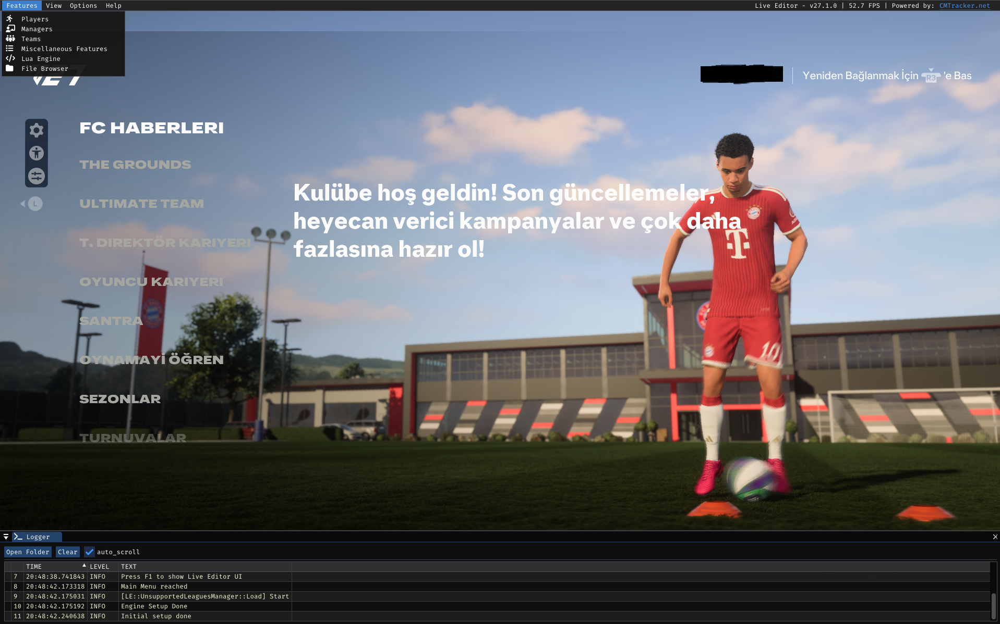

# FC27 Live Editor — Game Enhancer for Windows 10/11

   

---

FC27-Live-Editor is a free, no-strings-attached live editor for FC 27, built for players who'd rather tweak the game than wait in a paywall queue. No Patreon tier gates the latest build — every version ships free and ready the moment it drops. It hooks the game in memory at runtime, so you get live edits without permanent file changes. If you're here to push the game past its defaults, you're in the right repo.

## Features

- **No paywall, no Patreon** — every tool in the editor is unlocked for everyone. No donor tiers, no gated features, no "premium" version.
- **Instant updates after game patches** — when FC 27 drops a new title update, the editor ships a matching build right away. Free users don't wait in a queue while donors skip ahead.
- **Live in-memory editing** — values are patched while the game is running, so changes apply on the fly without restarting a match or reloading a save.
- **Launcher handles the launch** — the included launcher starts the game and hooks the editor in automatically. You don't need to configure paths or run anything separately.
- **F1 opens the overlay** — one key brings up the editor mid-game. Everything is driven from that in-game panel.
- **Single lightweight download** — the whole tool ships as one archive. Extract it, run it, play. No dependency chains, no package managers.
- **Built for FC 27 specifically** — the editor targets FC 27's current build and tracks its memory layout, not a generic last-gen tool with a rebrand.
- **Open development** — the project lives on GitHub, so you can follow commits, check what changed between versions, and see exactly what the editor does.
- **Antivirus false positives explained** — memory patching triggers heuristic flags on some scanners. That's expected behavior for a live editor, and the archive can be verified independently before you run it.

## How it works

The editor runs alongside FC 27 and hooks into the game's live memory — no file patching, no permanent changes. Launch the game, fire up the editor, and it attaches to the running process automatically.

From there you get a real-time overlay: F1 opens the panel, and every tweak you make applies instantly, mid-match or in the menus. Player attributes, team data, and career values are all editable on the fly — change something, watch it land in-game immediately.

Everything is session-based. Close the editor and the game keeps running with whatever state you left it in; restart and you're back to vanilla. Nothing gets baked into your save files unless you explicitly commit the change.

The whole thing is open source and community-driven — the code is right here in this repo, so you can read exactly what it does before you run it. No Patreon gate, no waiting for donor-only builds after a game update: every release ships free and current.

## Supported Games

Built and tuned for **FC 27** across PC, PlayStation, and Xbox — the editor hooks the live game session, so anything you tweak lands in real time whether you're on desktop or console.

Coverage is version-locked and update-tested. Every game patch gets validated before it ships here, so you're not staring at a broken tool after a title update. No donor queue, no waiting room — the current build supports the current game version from day one.

Platform support at a glance:

- **PC** — full feature set, launcher handles the game start for you.
- **PlayStation** — session-level editing, same feature parity as PC.
- **Xbox** — supported, updated alongside the other platforms.

Running a patched or mismatched game build? Check the release notes for the exact version match before you fire it up — the editor targets live sessions only and won't touch legacy builds.

## FAQ

**Is it actually free?** Yes. No Patreon, no paywall, no "donator tier" holding features back. Every tool in the editor is unlocked the moment you launch it.

**Do I have to wait after a game update?** No. Other editors park free users in a queue while donors jump ahead. FC27-Live-Editor ships every version free and ready the same day — no line, no delay.

**Will my antivirus flag it?** Possibly, and that's expected. The editor patches the game in memory, which is exactly the kind of behavior heuristic scanners hate. That's a false positive, not malware. Verify it yourself — drop the archive into a scanner and see for yourself, it takes seconds.

**Does it modify game files on disk?** No. Changes are applied live in memory while the game runs. Nothing gets baked into your install, so a restart wipes the slate clean.

**Which games does it support?** FC 27, full stop. It's built and tuned for that title — don't expect it to play nice with older entries in the series.

**How do I open the editor?** Launch through the included launcher, get in-game, then hit F1. That's the whole ritual.

**Is it a virus / will I get banned?** See above on the false positive. As for bans — you're modifying a live game, so the risk is yours to own. Nothing here guarantees safety on official servers.

**Do I need an account or login?** Nope. The launcher skips auth entirely. Download, extract, run.

**Can I contribute?** Absolutely. The project is open for development — fork it, patch it, send improvements.

## Disclaimer

Read this before you run anything. FC27-Live-Editor is a free, community-built tool — no Patreon gate, no paywall, no waiting in line behind donors. That's the whole point.

It works by patching the game in memory at runtime. It does not modify your game files on disk and it doesn't touch your account. Everything happens live, in-session, and disappears when you close the game.

Because it hooks into a running process, antivirus software will sometimes flag it as a false positive. That's expected behavior for memory editors, not evidence of malware. Don't take anyone's word for it — including ours. Drop the archive into a scanner you trust and verify it yourself before you extract it. Takes seconds.

What this tool is not: it's not a cheat for online competitive modes, it's not a bypass for anti-cheat systems, and it's not a replacement for owning the game. Use it in offline and single-player contexts where editing is fair game. If you take it online and get flagged, that's on you — not the project, not the contributors.

You use this at your own risk. Back up your saves. The maintainers ship every version free and ready, but they can't promise your specific game build, config, or platform won't break something. If it does, report it — don't blame it.

No ads, no telemetry, no hidden wallet miners. Just an editor, the way it should be.

